# 👋 Hi there, I'm Mothukuri Bharath

  
  
  
  

---

## 👨‍💻 About Me

- 🎓 **Education**: B.E. in **Computer Science & Artificial Intelligence** at Saveetha School of Engineering, Chennai.
- 🏆 **Hackathon Winner**: Placed **Top 3 at Hack with Hyderabad (24-Hour Hackathon)** — architected **IncidentMind**, an autonomous, self-learning incident response agent for fintech payment systems.
- 📱 **Mobile Creator**: Shipped **Detox**, a native Android productivity & screen-time manager engineered with Kotlin, Android Jetpack, and custom background usage monitors.
- 🧠 **AI & Machine Learning**: Hands-on experience developing ML predictive models, neuro-symbolic reasoning systems (Knowledge Graphs + Rules + ML), and LLM agentic workflows.
- 📜 **Oracle Certified**: Java SE 17 & MySQL.
- 🚀 **Currently Exploring**: Distributed agent systems, vector memory architectures, and scalable full-stack applications.

---

## 🛠️ Tech Stack & Toolbelt

### **Languages**

  
  
  
  
  
  
  
  

### **Web & Backend**

  
  
  
  
  
  
  

### **AI, ML & Data Science**

  
  
  
  
  
  
  

### **Mobile & Tools**

  
  
  
  
  
  
  

---

## 🚀 Featured Flagship Projects

| Project | Tech Stack | Highlights |
| :--- | :--- | :--- |
| **[⚡ IncidentMind](https://github.com/bharathnow/HackwithHyderabad)** | FastAPI, React, Tailwind, Groq, Hindsight Vectorize | **🏆 Top 3 Winner @ Hack with Hyderabad**. Autonomous, self-correcting incident response agent for fintech payment gateways. |
| **[🌿 Detox](https://github.com/bharathnow/Detox)** | Kotlin, Android SDK, Jetpack, Coroutines | Native Android digital wellbeing application featuring background usage monitoring, focus locks, and custom screen-time quotas. |
| **[🧠 Knowledge Engineering Lab](https://github.com/bharathnow/Knowledge_Engineering)** | Python, RDFLib, Scikit-Learn, Random Forest | Neuro-symbolic hybrid reasoning framework combining semantic knowledge graphs, certainty factor expert rules, and ML classifiers. |
| **[🌐 Personal Portfolio](https://github.com/bharathnow/bharathnow.github.io)** | HTML5, CSS3, JavaScript, GitHub Pages | Interactive developer portfolio featuring live project demonstrations, skill matrix, and digital resume viewer. |

---

## 📊 GitHub Analytics & Activity

  

    
    
  

  

    
  

---

## 📫 Let's Connect!

I am always keen to collaborate on impactful AI, Machine Learning, and Software Engineering projects.

- 💼 **LinkedIn**: [linkedin.com/in/mothukuribharath25](https://linkedin.com/in/mothukuribharath25)
- 🌐 **Portfolio**: [bharathnow.github.io](https://bharathnow.github.io)
- ✉️ **Email**: [bharathchowdary250@gmail.com](mailto:bharathchowdary250@gmail.com)
- 📍 **Location**: Chennai, India

---

  ⭐️ Designed with dedication by <a href="https://github.com/bharathnow">Mothukuri Bharath</a>

